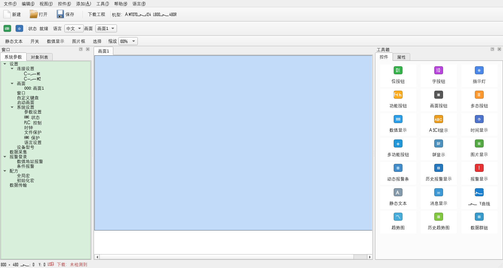

# KinSealStudio Lite 验证报告

更新日期：2026年11月9日。当前交付版本：0.4.3透明图库版。

0.4.3修正控件在图库图片下额外填白底的问题。原图Alpha正常，已通过失败像素回归确认根因；修复后画布、属性预览、三种图像模式及RGB565状态图保留透明区域，原有白色细节不删除。全部5647张资源在两种底色、三种显示模式下33882次比对零差异。新包为`dist/KinSealStudioLite-TransparentGallery/`；实际画布与设备编译回归、私有Windows验证结果见[设备台账](位按钮设备编译实现.md)。未访问USB。

0.4.2将左侧改为与原生截图一致的“系统图库”“扩展图库”两个平级目录，分别27和44个子分类，名称、层级及顺序均经原EXE静态构造核定。完整资源仍为75分类索引/5647张，未挂原生可见叶子的243张继续从父级汇总及全库搜索访问。新包为`dist/KinSealStudioLite-NativeGallery/`。目录、分页、全库搜索、取消及原图所在页回归结果见[设备台账](位按钮设备编译实现.md)。

0.4.1补全原图库遗漏的12张PNG和1张SVG，合计75分类/5647图片，新增父级汇总、全库搜索、分页和当前图片所在页定位。全部图片资源SHA与原安装或原EXE一致，全部解析/绘制通过；原缺失关联PNG等限制保持。程序包为`dist/KinSealStudioLite-Gallery/`，本次未访问USB、未关闭用户运行中的旧位按钮版。详见[设备台账图库补全](位按钮设备编译实现.md)。

0.4已接通位按钮、权限文本、多语言、真实SDK宏编译、默认Modbus设备地址与扫描表，以及受支持的原厂源工程读写。四操作测试工程已通过新版独立USB入口传输，数据段及提交获确认、重启命令已发送，实际交替/置位/复位/点动尚无现场反馈。**全部实机验收未完成**。完整范围、原厂对照及最终构建记录见[位按钮手册实现与验收](位按钮手册实现与验收.md)和[设备编译台账](位按钮设备编译实现.md)。

原0.4包为`dist/KinSealStudioLite-BitButton/`；SDK不捆绑，用户关机要求已取消。其它PLC设备驱动、多页面及动态控件重叠等尚未开放的能力，不能由现有离线测试推定实现。

## 2026年11月8日及此前的静态文本历史记录

下列测试数量、拒绝范围和包目录属于当时版本，保留用于追溯；0.4当前状态以上方台账为准。历史静态文本的屏端确认不能扩大为位按钮触控验收。

本轮静态文本手册的逐项实现、原厂预览对照和未完成项见 [静态文本手册实现与验收](静态文本手册实现与验收.md)。新包目录为 `dist/KinSealStudioLite-StaticText/`；下文保留此前下载链路的历史验证，不能把此前的屏端确认扩大到本轮所有新属性或动态权限。

本轮补充结果：私有 Windows 桌面测试 12 通过、0 失败；原厂 13 种默认填充预览采样对照的最大单通道差异不超过 2，粗体 TEST 的 RGB565 帧逐字节一致。新版独立下载两行文字、白字粗体下划线与蓝青渐变样例后，用户确认“文字、样式和位置都正确”。用户已明确选择先验收编辑与外观、显现权限实机验证稍后；权限设备编译仍被明确拒绝。完整测试覆盖及剩余边界以本轮验收文档为准。

## 对用户目标的判定

| 用户要求 | 当前结果 | 验收结论 |
| --- | --- | --- |
| 编写最小工程 | 已导出含“TEST”静态文本的原生 `.sm`，并由原厂隔离副本编译出 `.kns` | 固定单文本工程通过离线检查和实屏显示验证 |
| 界面与原程序一样 | 已调整为 1376×736 参考尺寸、三栏、页面标签、三排工具栏和工具箱顺序 | 未达到完全一致；工具栏图标、功能与细节仍不同 |
| 将写好的程序下载到实物屏 | TEST、位移后的 AB12、中文 240×90 文本框及三行文本均由新版独立下载；用户确认这些样例的文字和位置正确 | 单静态文本的文字、位置、尺寸及显式多行下载闭环通过 |
| 在屏上确认显示和触摸 | 用户确认实物屏显示 TEST、AB12、“测试中文AB”及三行文本，且文字位置正确；样例没有触摸控件 | 静态画面显示通过；触摸操作未验证 |

原厂隔离副本的参考截图是 `references/vendor-text-editor.bmp`，本原型离屏预览是 `artifacts/KinSealStudioLite-preview.png`，均为 1376×736。离屏图不含 Windows 标题栏，故不进行像素级评分。三栏宽度、画布比例和工具箱排布已接近参考；原厂密集图标工具栏、菜单行为、工程树图标等仍未完整复现。

## 已完成的验证

- 针对用户打开 `CodexProbeTest.sm` 时的“illegal number”：修复前命令行读取同目录 `.ksp` 返回 0、读取 `.sm` 返回 7；`.sm` 前 16 字节为原厂二进制数据，不是 JSON。修复后，正式读取入口可导入该 `.sm`；导入后重新导出的 3887 字节文件与原文件 SHA-256 一致，修改一个非文本字节的同尺寸 `.sm` 会被拒绝。独立后台桌面中从新版“打开”按钮实际载入 `.sm`，窗口标题变为 `CodexProbeTest`；随后点击“保存”出现“保存原型工程”对话框，原始 `.sm` 字节未变化。便携部署包也包含该 `.sm` 并通过导入自测。

- 使用 Qt 6.12.0、MinGW 13.1、CMake 3.30.5 和 Ninja 构建 Windows 64 位 Release 程序；C++ 编译未报告警告或错误。构建脚本改用等待进程退出并检查真实退出码的方式运行自测，便携部署包复测通过。
- 运行内置 `.ksp` 往返测试，覆盖文件写入、读取、目标型号、800×480 分辨率和控件几何恢复，确认错误分辨率会被拒绝、控件放置/移动不会越过画布边界，且控件数量不会超过 100。
- 验证样例工程 `samples/下载链路验证.ksp`；便携部署包内再次运行往返测试和样例工程解析测试。
- 通过 Qt `offscreen` 平台生成 1376×736 界面预览；原厂截图和编译操作在独立 Windows 桌面中的隔离副本完成，没有切换、遮挡或操作用户桌面。
- Windows USB 设备状态检查只读取即插即用枚举；新版下载按钮调用自身的隐藏进程，通过系统 `libusb0.dll` 直接打开 USB 并发送数据。2026年11月8日，`Get-PnpDevice -PresentOnly` 已列出状态为 `OK` 的 `Smart Control Device`（`USB\\VID_7365&PID_616C`）。
- 本项目从内置模板导出 `CodexProbeTest.sm`，SHA-256 与已由原厂成功打开并显示“TEST”的工程相同（`AADEC3DA…4F9422`）。原厂隔离副本将该工程离线编译为 `samples/native-device-test/compile-test/load.kns`（12623 字节）；ZIP 14 个条目完整，`upLoad.knr` 解压长度 4023 字节，其中包含“TEST”而没有“TEXT”。该验证只覆盖一个固定位置、四字符静态文本的原生源工程。
- 用户于 2026年11月8日确认：在原生软件中下载本项目的 `CodexProbeTest.sm` 后，实物屏显示“TEST”。这是用户现场报告的屏端证据；本项目没有独立采集屏幕照片、屏内读回或断电重启结果。
- 历史桥接版本：后台桥接直接运行 `CodexProbeTest.sm` 下载，隔离原厂窗口显示“下载完成”，脚本返回成功；失败和无进展状态不会报告成功。该版本的便携包位于 `dist/KinSealStudioLite-USB/`，不是当前独立下载交付包。
- 历史桥接版本的界面验证：用户让实物屏重新进入 USB 下载模式后，在独立 Windows 桌面打开 `CodexProbeTest.ksp` 并触发工具栏“下载工程”，弹窗正文为“原厂隔离运行时报告 USB 下载完成。请检查触摸屏显示。”；后台截图位于 `artifacts/Qt-USB-download-complete.bmp`。这是旧桥接调用链的结果，不代表当前独立下载版调用原厂运行时。
- 独立下载版对十个内置 TEST 数据文件逐一检查长度和 SHA-256。原厂六轮抓包的传输顺序和响应与新版状态机逐项核对；新版将原厂命令中未初始化的尾字节清零，保留开始选项、程序字节数和压缩档案长度。使用系统 64 位 `libusb0.dll` 直接发送两条识别命令，收到与抓包逐字节相同的两次 24 字节应答。
- 在没有打开原厂软件或加载原厂 DLL 的情况下，从 `dist/KinSealStudioLite-Independent/KinSealStudioLite.exe` 后台执行 `--download-native-test CodexProbeTest.sm`。十个数据块、每段状态检查及提交命令均取得预期 `'O'` 应答，最后发送重启命令，进程退出码 0；用户现场确认实物屏显示 **TEST**。实机验证未切换用户桌面。便携包和源码构建的自测通过，非 TEST 样例被拒绝，返回码 14，未打开 USB。
- 当前独立下载版的界面验证：在私有 Windows 桌面启动 `dist/KinSealStudioLite-Independent/KinSealStudioLite.exe`，通过“打开”载入 `CodexProbeTest.ksp`，再触发工具栏“下载工程”。界面最终显示“USB 传输完成”，正文确认数据段和提交命令已获设备确认、重启命令已发送；`PrintWindow` 后台截图位于 `.scratch/kinseal-20261108/qt-download-result.bmp`。该测试没有切换或操作用户桌面；私有桌面进程已退出。
- 单文本差分样本：用原厂隔离副本生成同输入重复编译、TEST、AB12、AAAA 及位移 AB12。重复编译确认 `SheetPixel.dat` 与 `upLoad.knr` 稳定；`SysPara.dat`、`AlarmPara.dat` 和 `Usbload.bin` 会变化，因此新版保留已验证的固定数据，只重建文字相关段。样本保存在 `.scratch/kinseal-20261108/corpus/`。
- `SheetPixel.dat` 经原厂 `minilzo.dll` 解压为 768000 字节的 800×480 RGB565 帧。Qt 6 的微软雅黑 12pt 光栅化修正纵向 1 像素后，AB12、位移 AB12、AAAA 三组新生成帧与原厂帧逐字节一致；SHA-256 分别为 `4f206470…e18d01`、`5d70fed8…306a3a`、`910a1e00…e79af5`。新 LZO1X 编码结果由原厂解码器成功还原；`PicLenPara.dat` 首个小端长度与各自压缩帧大小一致。`upLoad.knr` 可解压，含三处新文本及目标坐标。固定 TEST 生成的十个段与已实屏验证的数据逐字节一致。
- `Build.ps1` 运行无可见窗口的 Windows 字体差分回归，以及不支持型号、控件和越界几何的编译前拒绝测试；Release 构建通过。2026年11月8日，Windows 枚举到状态 `OK` 的 `7365:616C`，后台运行 `--download-single-text AB12-shift.ksp` 退出码 0；十个数据段和提交命令均收到预期确认，重启命令已发送。
- `Build.ps1 -Deploy` 生成独立便携包 `dist/KinSealStudioLite-SingleText/`，随包提供 LZO 编码器 MIT 许可文本；部署包中的编译回归也通过。在私有 Windows 桌面打开此便携版、载入位移后的 AB12 `.ksp`，通过工具栏“下载工程”触发新版链路；弹窗显示“USB 传输完成”，提示核对屏幕文字和位置。`PrintWindow` 后台截图位于 `.scratch/kinseal-20261108/qt-download-result.bmp`，测试未切换用户桌面。
- 本轮扩展单文本编译：原厂隔离副本接受单字符、12 字符英文、中文、空文本、90×30、240×90、窄框裁切以及两行、三行文本。新版按 UTF-16BE 写入可变长度字符串，更新三个长度字段和两组几何字段。短文本、中文、空文本、不同尺寸及多行样本中，多个 RGB565 帧与原厂逐字节相同；`HELLOWORLD12` 在 150×50 框中有 118 个像素、90×30 框中有 51 个像素差异，集中于字距。固定 TEST 数据段仍逐字节一致。
- 对 `测试中文AB`、240×90 的 `.ksp` 离线编译，十个数据段齐全；原厂 LZO 解码器还原的 800×480 RGB565 帧与原厂差分样本逐字节一致。新版后台独立 USB 下载的全部数据段、提交应答和重启命令成功；用户确认实物屏文字和位置正确。1200 字符的压力样本也已成功离线编译，但未用于实机下载，不能推定原厂对所有长度均支持。
- 新便携版 `dist/KinSealStudioLite-GeneralText/` 在私有 Windows 桌面打开三行 `.ksp`；属性页能呈现多行文本编辑控件。从工具栏触发独立下载，窗口显示“USB 传输完成”，后台 `PrintWindow` 截图保存在 `.scratch/kinseal-20261108/qt-download-result.bmp`。USB 应答通过，用户确认屏上三行文字和位置正确；整个过程没有操作用户桌面。
- 在同一私有桌面中选中三行样例的静态文本框，将属性页文本改为“新版长文本”与“测试中文”两行并点击“应用属性”；画布随即显示新文字，后台截图位于 `.scratch/kinseal-20261108/qt-general-text-edited.bmp`。这验证了属性编辑到画布的入口，没有对该临时修改执行 USB 写屏。
- 最终 `Build.ps1 -Deploy` 在 Windows PowerShell 5 中通过：构建、内置段校验、工程往返、拒绝路径、原厂帧哈希回归、样例校验和便携包自测均成功。脚本保存为 UTF-8 BOM，以免 PowerShell 5 将中文样例路径常量误解码；测试时还使用字节相同的 ASCII 路径副本调用 MinGW 程序。

## 当前限制

当前 `.ksp` 仍是独立 JSON 原型格式；`.sm` 导入/导出仍限定旧固定模板的四字符静态文本。独立下载支持目标型号、一个 800×480 画面、一个静态文本控件，文本和屏内位置、宽、高可变。其他控件、多个对象与其他机型会在打开 USB 前拒绝。程序尚无法把任意画布编译成 `.kns`；字体光栅化依赖 Windows 中的微软雅黑字体，长英文样本存在少量字距像素差异。新版便携包不依赖原厂运行时、原厂 DLL 或 Python；目标电脑需要适配该屏的 `libusb-win32` 驱动。

TEST、AB12、中文 240×90 和三行文本的实屏结果证明固定包及变更文字、位置、尺寸、显式多行后的单文本工程均能经新版软件直接 USB 下载并显示。样例只有静态文本，不能验证触摸响应；屏内读回、断电保持和其他控件下载也需后续验证。

## 界面预览

## 2026年11月9日协议知识归档补充

已将截至0.4.3掌握的USB段时序、640B type10/type28控制字段、图像长度/压缩/偏移、36B地址槽、默认Modbus扫描、宏RAW容器、Qt4源工程及图库透明栅格规则，追加到[USB协议文档第11至19节](AMT070W124-L800X480R_USB下载协议_已验证部分.md#11-2026年11月9日协议知识快照截至043)。

本次仅整理既有证据并复核偏移/宽度/字节序和链接，没有修改业务程序、重跑设备测试或访问USB。原厂宏USB时序明确按bulk替换后的主机流程记录，不当作真实设备ACK；普通宏位于history.1e4内、系统/配置SHA指纹范围外的表述已更正。单态只输出OFF图、编码标志首字节与剩余字节边界、默认PLC配置限制及全部实机待确认项均保留。既有0.4.3测试数量仅引用原记录，不计为本轮新测试。
